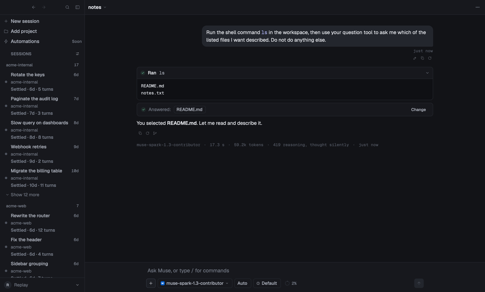

<div align="center">


# Baaz

**A native macOS workspace for the coding agents you already use —
Claude Code, Codex and Muse Code.**

Baaz runs each agent's own CLI and draws its sessions as one app: a
transcript with real approval and question cards, the session's changes and
files beside it, a terminal, and a browser the agents can work in.

</div>



## What it does

- **Three providers, one window.** Sessions on Claude Code, Codex and Muse
  Code side by side, each driven through its own CLI (`claude`, `codex
  app-server`, `muse serve`) and signed in the way that CLI signs in. A
  session can be handed off to another provider mid-task.
- **A streaming transcript** with markdown, reasoning and tool calls folded
  into readable cards, per-turn usage, Stop, and steering a running turn
  where the provider supports it. A control appears only on a provider that
  can do it.
- **Approvals and questions as real UI**, with the choices each provider
  actually offers; the sidebar row says when a session is waiting on you.
- **The session's workspace on the right:** its changes against git (commit
  what this session touched, push, open a PR), the project's files with a
  preview, and the pages it opened.
- **A terminal** docked under the transcript, which agents can also run
  commands in.
- **Browse mode:** a Chromium browser with spaces, tabs and bookmarks, and
  an assistant that can read and act on pages — asking before it uses one
  of your own tabs on a new site.
- **Projects and sessions:** one window over several folders, grouped by
  project, with per-project defaults; resume, rename, fork, archive;
  full-text search; import of earlier Claude Code and Codex sessions.
- Skills, a command palette, light and dark themes, and a keyboard-first
  keymap.

## Using it

1. **Connect a provider.** The first launch lists Claude Code, Codex and
   Muse Code with what each needs: install it, or sign in. One is enough.
2. **Start a session** with ⌘N. With no project yet it runs in
   `~/baaz-sessions`; add a project folder to work in your own code.
3. **Answer approvals** in the card, or with the number keys. A session
   waiting on you says so in the sidebar.
4. **Review on the right**: Changes shows what the session edited, and
   Commit takes only those files.

`/` for commands and skills, `@` to mention a file, `⌘K` for the palette,
`⌘⇧F` to search sessions. Every key is in
[`docs/08-keymap.md`](docs/08-keymap.md).

## Requirements

- **macOS 14 (Sonoma) or later**
- **Rust 1.85+** and the Xcode command line tools (`xcode-select --install`)
- At least one agent CLI on your `PATH`, signed in: `claude` (Claude Code),
  `codex` (Codex), or `muse` (Muse Code).
- For Browse mode, a CEF binary distribution under `~/.local/share/cef`;
  without it `scripts/bundle.sh` builds the app with the system web view and
  no Browse mode.
- Nothing else. The [`aui`](https://github.com/latekaapi/agentic-ui)
  component library is a git dependency pinned to a tag, so `cargo` fetches
  it for you.

## Building and running

```sh
git clone https://github.com/latekaapi/baaz
cd baaz
cargo run -p baaz                                # workspace = $PWD
cargo run -p baaz -- --workspace ~/code/thing    # somewhere else
```

A distributable `.app` bundle:

```sh
scripts/bundle.sh                    # builds target/bundle/Baaz.app
open target/bundle/Baaz.app
```

## Cost — read this first

**Every real turn spends on the provider's account.** Baaz sends what you
type to the agent you picked, on that agent's own plan or key. On Muse a
pay-as-you-go login bills every turn as API usage, so Baaz checks the plan
and warns before sending on that lane.

What costs nothing:

```sh
cargo run -p baaz -- --replay fixtures/msp/transcript-approve.jsonl   # a checked-in capture, no agent at all
cargo run -p baaz -- --no-connect                                     # draws the chrome, no agent
cargo test --workspace                                                # never starts an agent CLI
```

[`docs/06-billing.md`](docs/06-billing.md) has the Muse plan details, and
[`CONTRIBUTING.md`](CONTRIBUTING.md) the scripting surface — `--steps`,
`--screenshot`, and which step verbs spend a turn.

## How it is put together

```
crates/provider               the provider seam: commands, events, capabilities
crates/provider-claude-code   Claude Code over stream-json stdio
crates/provider-codex         Codex over `codex app-server` (JSON-RPC)
crates/provider-muse          Muse Code over MSP, on muse-client + muse-adapter
crates/session-store          the transcript model the app renders
crates/mcp-bridge             Baaz's own tools (terminal, browser) for the agents
crates/baaz                   the gpui application
fixtures/                     checked-in wire captures for every provider
```

Every capture under `fixtures/` is folded in the test suite, so the app's
reading of each protocol is pinned by real traffic. `cargo test --workspace`
never spawns an agent and never spends a turn.

| file | what it covers |
|---|---|
| [`docs/07-architecture.md`](docs/07-architecture.md) | the crates, the thread model and the fold |
| [`docs/08-keymap.md`](docs/08-keymap.md) | every key, as built |
| [`docs/12-projects.md`](docs/12-projects.md) | projects: design and data model |
| [`docs/12-search.md`](docs/12-search.md) | full-text search: storage and indexing |
| [`docs/14-terminal.md`](docs/14-terminal.md) | the terminal and the agents' use of it |
| [`docs/22-handoff.md`](docs/22-handoff.md) | handing a session to another provider |
| [`CHANGELOG.md`](CHANGELOG.md) | what changed |

## Status

Pre-1.0, macOS only, built from source. The bundle is ad-hoc signed (it
runs on the machine that built it) and has no updater yet. Each provider's
protocol is versioned by its own CLI; Baaz states the oldest version it
supports and may need updating against newer ones. Expect rough edges.

## License

MIT — see [`LICENSE`](LICENSE).

## Credits

Built on [gpui](https://www.gpui.rs) — the UI framework behind
[Zed](https://zed.dev) — the `gpui-kit` component kit, and the `aui`
component library (which uses [Geist](https://vercel.com/font) fonts).
Talks to Claude Code, Codex and [Muse Code](https://github.com/facebookresearch/muse) through their own CLIs.
